# Scenario sweep: simlingo_nmpc on one route of each Bench2Drive type

Run 15 Nov 2026, 05:53–09:08, on commit `b012cdd` (branch `lane-band-worker-timing`). One route per type, 39 types (the 44 minus the five highway and yielding ones: YieldToEmergencyVehicle, MergerIntoSlowTraffic, MergerIntoSlowTrafficV2, HighwayExit, SequentialLaneChange). Each route is the one tried before where there was one, otherwise the first of its five.

```
scripts/run_bench2drive.sh --agent simlingo_nmpc --routes <r> --tries 1 --no-cot --fast --video
```

## Summary

- **28 of 39 passed** (100 %, no infractions); 11 failed.
- Mean driving score over the 39: **82.2**.
- Failures by kind: 6 collisions (5 with vehicles, 1 with a pedestrian), 3 stuck and never finished (EnterActorFlow, GreenLight, ControlLoss), 1 off road and out of time (InterurbanActorFlow), 1 rule (ran a stop sign).
- **Junctions are the weak spot**: 5 of the 11 failures are junction gap decisions (left turns across traffic, joining a flow, a vehicle taking priority). Going round obstacles is strong: 10 of 11 pass.
- Every run also logs `min_speed_infractions`; Bench2Drive does not penalise them (penalty stays 1.0) and they are left out below.

| Group | Passed |
|---|---|
| Obstacles in our lane: go round them | 10 / 11 |
| Cars cutting in or stopping ahead | 4 / 5 |
| Junctions: turning across or into traffic | 7 / 12 |
| Pedestrians and cyclists crossing | 3 / 5 |
| Traffic rules only (no scenario actor) | 4 / 6 |

### Obstacles in our lane: go round them

| # | Type | Route | Score | Route done | Infractions | Video |
|---|---|---|---|---|---|---|
| 1 | ParkedObstacle | 1 | ✅ 100.0 | 100.0 % | — | [video](videos/001_ParkedObstacle.mp4) |
| 2 | ParkedObstacleTwoWays | 37 | ✅ 100.0 | 100.0 % | — | [video](videos/037_ParkedObstacleTwoWays.mp4) |
| 3 | ConstructionObstacle | 30 | ✅ 100.0 | 100.0 % | — | [video](videos/030_ConstructionObstacle.mp4) |
| 4 | ConstructionObstacleTwoWays | 4 | ✅ 100.0 | 100.0 % | — | [video](videos/004_ConstructionObstacleTwoWays.mp4) |
| 5 | Accident | 32 | ✅ 100.0 | 100.0 % | — | [video](videos/032_Accident.mp4) |
| 6 | AccidentTwoWays | 6 | ✅ 100.0 | 100.0 % | — | [video](videos/006_AccidentTwoWays.mp4) |
| 7 | HazardAtSideLane | 2 | ✅ 100.0 | 100.0 % | — | [video](videos/002_HazardAtSideLane.mp4) |
| 8 | HazardAtSideLaneTwoWays | 71 | ✅ 100.0 | 100.0 % | — | [video](videos/071_HazardAtSideLaneTwoWays.mp4) |
| 9 | VehicleOpensDoorTwoWays | 73 | ❌ 60.0 | 100.0 % | collisions_vehicle | [video](videos/073_VehicleOpensDoorTwoWays.mp4) |
| 10 | BlockedIntersection | 20 | ✅ 100.0 | 100.0 % | — | [video](videos/020_BlockedIntersection.mp4) |
| 11 | InvadingTurn | 41 | ✅ 100.0 | 100.0 % | — | [video](videos/041_InvadingTurn.mp4) |

### Cars cutting in or stopping ahead

| # | Type | Route | Score | Route done | Infractions | Video |
|---|---|---|---|---|---|---|
| 12 | ParkingCutIn | 0 | ✅ 100.0 | 100.0 % | — | [video](videos/000_ParkingCutIn.mp4) |
| 13 | StaticCutIn | 39 | ❌ 36.0 | 100.0 % | collisions_vehicle | [video](videos/039_StaticCutIn.mp4) |
| 14 | HighwayCutIn | 24 | ✅ 100.0 | 100.0 % | — | [video](videos/024_HighwayCutIn.mp4) |
| 15 | HardBreakRoute | 79 | ✅ 100.0 | 100.0 % | — | [video](videos/079_HardBreakRoute.mp4) |
| 16 | ParkingExit | 7 | ✅ 100.0 | 100.0 % | — | [video](videos/007_ParkingExit.mp4) |

### Junctions: turning across or into traffic

| # | Type | Route | Score | Route done | Infractions | Video |
|---|---|---|---|---|---|---|
| 17 | SignalizedJunctionLeftTurn | 103 | ❌ 28.6 | 47.6 % | collisions_vehicle | [video](videos/103_SignalizedJunctionLeftTurn.mp4) |
| 18 | NonSignalizedJunctionLeftTurn | 10 | ✅ 100.0 | 100.0 % | — | [video](videos/010_NonSignalizedJunctionLeftTurn.mp4) |
| 19 | SignalizedJunctionLeftTurnEnterFlow | 210 | ❌ 29.9 | 49.9 % | collisions_vehicle | [video](videos/210_SignalizedJunctionLeftTurnEnterFlow.mp4) |
| 20 | NonSignalizedJunctionLeftTurnEnterFlow | 208 | ✅ 100.0 | 100.0 % | — | [video](videos/208_NonSignalizedJunctionLeftTurnEnterFlow.mp4) |
| 21 | SignalizedJunctionRightTurn | 8 | ✅ 100.0 | 100.0 % | — | [video](videos/008_SignalizedJunctionRightTurn.mp4) |
| 22 | NonSignalizedJunctionRightTurn | 13 | ✅ 100.0 | 100.0 % | — | [video](videos/013_NonSignalizedJunctionRightTurn.mp4) |
| 23 | InterurbanActorFlow | 136 | ❌ 57.2 | 88.6 % | collisions_layout, outside_route_lanes | [video](videos/136_InterurbanActorFlow.mp4) |
| 24 | InterurbanAdvancedActorFlow | 132 | ✅ 100.0 | 100.0 % | — | [video](videos/132_InterurbanAdvancedActorFlow.mp4) |
| 25 | EnterActorFlow | 19 | ❌ 26.7 | 26.7 % | — | [video](videos/019_EnterActorFlow.mp4) |
| 26 | OppositeVehicleRunningRedLight | 9 | ✅ 100.0 | 100.0 % | — | [video](videos/009_OppositeVehicleRunningRedLight.mp4) |
| 27 | OppositeVehicleTakingPriority | 14 | ❌ 22.5 | 59.5 % | collisions_layout, collisions_vehicle, outside_route_lanes, route_dev | [video](videos/014_OppositeVehicleTakingPriority.mp4) |
| 28 | CrossingBicycleFlow | 54 | ✅ 100.0 | 100.0 % | — | [video](videos/054_CrossingBicycleFlow.mp4) |

### Pedestrians and cyclists crossing

| # | Type | Route | Score | Route done | Infractions | Video |
|---|---|---|---|---|---|---|
| 29 | DynamicObjectCrossing | 122 | ✅ 100.0 | 100.0 % | — | [video](videos/122_DynamicObjectCrossing.mp4) |
| 30 | ParkingCrossingPedestrian | 63 | ❌ 50.0 | 100.0 % | collisions_pedestrian | [video](videos/063_ParkingCrossingPedestrian.mp4) |
| 31 | PedestrianCrossing | 113 | ✅ 100.0 | 100.0 % | — | [video](videos/113_PedestrianCrossing.mp4) |
| 32 | VehicleTurningRoute | 17 | ✅ 100.0 | 100.0 % | — | [video](videos/017_VehicleTurningRoute.mp4) |
| 33 | VehicleTurningRoutePedestrian | 18 | ❌ 80.0 | 100.0 % | stop_infraction | [video](videos/018_VehicleTurningRoutePedestrian.mp4) |

### Traffic rules only (no scenario actor)

| # | Type | Route | Score | Route done | Infractions | Video |
|---|---|---|---|---|---|---|
| 34 | VanillaSignalizedTurnEncounterRedLight | 25 | ✅ 100.0 | 100.0 % | — | [video](videos/025_VanillaSignalizedTurnEncounterRedLight.mp4) |
| 35 | VanillaSignalizedTurnEncounterGreenLight | 114 | ❌ 0.0 | 0.0 % | — | [video](videos/114_VanillaSignalizedTurnEncounterGreenLight.mp4) |
| 36 | VanillaNonSignalizedTurn | 26 | ✅ 100.0 | 100.0 % | — | [video](videos/026_VanillaNonSignalizedTurn.mp4) |
| 37 | VanillaNonSignalizedTurnEncounterStopsign | 29 | ✅ 100.0 | 100.0 % | — | [video](videos/029_VanillaNonSignalizedTurnEncounterStopsign.mp4) |
| 38 | T_Junction | 193 | ✅ 100.0 | 100.0 % | — | [video](videos/193_T_Junction.mp4) |
| 39 | ControlLoss | 80 | ❌ 14.4 | 14.4 % | — | [video](videos/080_ControlLoss.mp4) |

## What went wrong, one failure at a time

Times are simulation seconds. Each analysis comes from the planner's log (`runs/<name>/viz/bench2drive_<r>/nmpc.jsonl`; the timeline around each infraction is in `analysis/<name>.txt`, made by `tools/timeline.py`). Each frame is from the video at the moment it went wrong (left: chase view, right: from above; green = SimLingo's path, magenta = NMPC plan).

### VanillaSignalizedTurnEncounterGreenLight (route 114): Never moved: a stop gate 5.9 m ahead never cleared

**Stuck at start**. Score 0.0, route 0.0 % done. `Failed - Simulation crashed (watchdog: ego at rest for 30 s)`. [Video](videos/114_VanillaSignalizedTurnEncounterGreenLight.mp4)

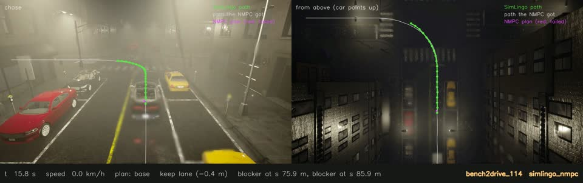

**What happened.** The car never moved (0 % of the route). From the very first plan there was a stop gate 5.9 m ahead
(`gates: [[5.9, 0.0, …]]`) and another at 56.4 m. The light was green (the scenario's whole point), but the
gate stayed for 30 s and the watchdog ended the run. The planner noted two blockers 76–86 m ahead.

**Why.** The 5.9 m gate is probably a stop line or light that is not ours (or a stale red). The log does not say
which source made the gate, so this needs a look.

**What to try.** Log the source of every gate; check which light or line is at 5.9 m from route 114's start.

### ControlLoss (route 80): Treated the debris as blockers and waited to go round

**Stuck**. Score 14.4, route 14.4 % done. `Failed - Simulation crashed (watchdog: ego at rest for 30 s)`. [Video](videos/080_ControlLoss.mp4)

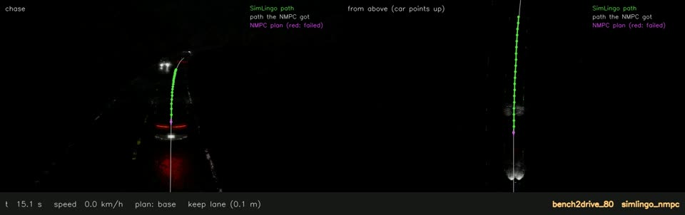

**What happened.** The scenario puts debris on the road to drive over. The planner treated the pieces as **blockers** (at 25,
58 and 84 m) and wanted to go round through the oncoming lane: "blocker: oncoming traffic, waiting". It slowed from
3.4 m/s to a stop at t ≈ 9.75 s, 24.5 m before the first piece, and waited until the watchdog. 14.4 % of the route.

**Why.** Debris is a small static object that should be driven over, not avoided.

**What to try.** Ignore objects lower than the car's ground clearance (debris), or classify ControlLoss props as drive-over.

### OppositeVehicleTakingPriority (route 14): Hit by the fire truck that took priority

**Collision → off route**. Score 22.5, route 59.5 % done. `Failed - Agent deviated from the route`. [Video](videos/014_OppositeVehicleTakingPriority.mp4)

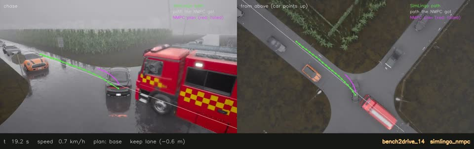

**What happened.** At the unsignalised junction the planner judged it could cross ahead of car 3717 and merge ahead of 3696,
the fire truck that does not yield (`merge:3696`, "merging in at 1.6 s"). It accelerated to 9.8 m/s, then
braked very hard (−16.9 m/s² on one step; several plans failed and were held) and stopped at t ≈ 19 s, but the
fire truck clipped it at t ≈ 19.25 s. Afterwards it hit a fence (t ≈ 27 s), went 1.5 m outside its lanes, and
left the route at t ≈ 32 s, which ended the run.
**This route scored 100 % on 15 Nov**, so this type is not reliably passed.

**Why.** It went for a gap ahead of a vehicle that the scenario makes take priority, and after the near miss it
lost the path.

**What to try.** Yield to any vehicle on a crossing course that is not slowing down; after a collision, rejoin the lane rather than steering anywhere.

### EnterActorFlow (route 19): Never found a gap to join the flow

**Stuck**. Score 26.7, route 26.7 % done. `Failed - Simulation crashed (watchdog: ego at rest for 30 s)`. [Video](videos/019_EnterActorFlow.mp4)

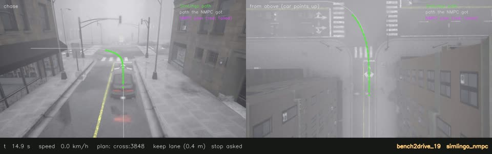

**What happened.** Crept up to the junction and stopped at t ≈ 11 s, 26.7 % of the way along. It never moved again;
the 30 s watchdog stopped it. The candidate was `cross:<id>` with the target changing from car to car
(3825, 3836, 3837, … 3848), and SimLingo was asking to stop ("stop asked"). No infraction.

**Why.** Every gap was judged too small. The flow is continuous, and our merge needs more room than it ever gets;
PDM-Lite accepts smaller gaps (see learnings for route 8: "Route 8's gaps fit only without margin").

**What to try.** Use PDM-Lite's gap acceptance for EnterActorFlow; don't let SimLingo's stop request hold the car when the gap check says go.

### SignalizedJunctionLeftTurn (route 103): Turned left in front of oncoming traffic

**Collision → stuck**. Score 28.6, route 47.6 % done. `Failed - Simulation crashed (watchdog: ego at rest for 30 s)`. [Video](videos/103_SignalizedJunctionLeftTurn.mp4)

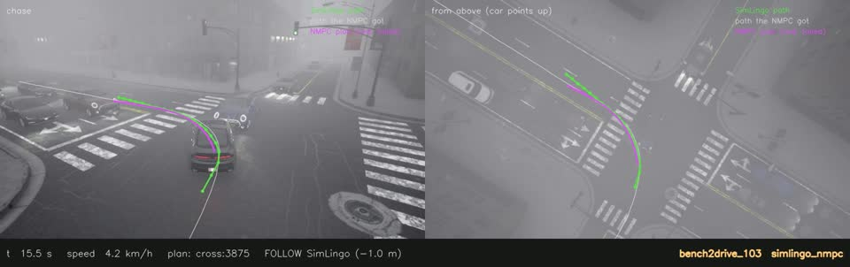

**What happened.** Went at green, accelerating hard (up to 6.6 m/s²) to 9.4 m/s on `cross:3875`, judging it could go in
front of car 3875. An oncoming car (id 3873) was in the predicted crossing area the whole time
("crosser in the lane from 0.0 s…"). It hit us at t ≈ 14.8 s in the middle of the junction. Then the car stood
there until the 30 s watchdog. Same failure as on 15 Nov (26.9 % then, 28.6 % now).

**Why.** The crossing check only looked at the one car it chose to go ahead of (3875) and not at 3873, which
was already in the crossing area. Committing at full acceleration left no room to stop.

**What to try.** Check every car that is predicted to be in the crossing area, not only the chosen one; don't start the turn while any car is already in the conflict zone.

### SignalizedJunctionLeftTurnEnterFlow (route 210): Stop-and-go in the junction, hit by the flow

**Collision → stuck**. Score 29.9, route 49.9 % done. `Failed - Simulation crashed (watchdog: ego at rest for 30 s)`. [Video](videos/210_SignalizedJunctionLeftTurnEnterFlow.mp4)

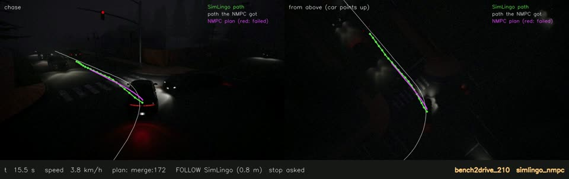

**What happened.** Turning left at a light into a road that oncoming cars also turn into. The plan switched between
`cross:172`, `base` and `merge:172` every half second, crawling at 0–3 m/s inside the junction. It stopped at
t ≈ 14.75 s, started again on `merge:172`, and car 172 hit it at t ≈ 15.6 s. Then it stood until the
watchdog. SimLingo was also asking to stop ("stop asked" on the video bar).

**Why.** The plan keeps switching between candidates, so the car neither commits nor waits. Car 172 was both the one it
crossed ahead of and the one it merged behind.

**What to try.** Make the candidate choice stick for a while (hysteresis) inside a junction, and don't restart from rest in front of a car that is 3 m away.

### StaticCutIn (route 39): Too fast past a stopped queue; the cut-in car hit us side-on

**Collision**. Score 36.0, route 100.0 % done. `Completed`. [Video](videos/039_StaticCutIn.mp4)

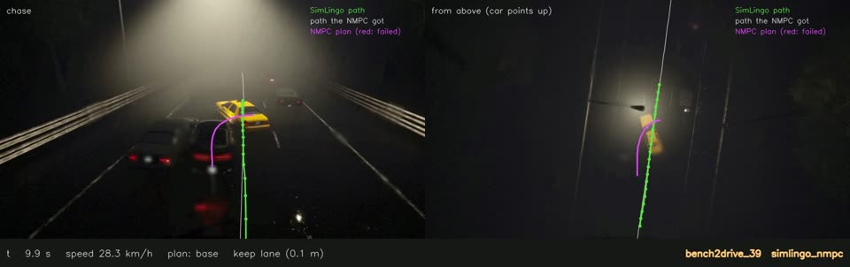

**What happened.** The scenario parks a queue of cars in the lane to our left; one of them cuts into our lane. Our car accelerated
at about 4 m/s² to **17.4 m/s (63 km/h)** on the base plan, beside the stopped queue, with no note about it in the
planner. The cut-in car (id 3708) sat 3.4 m to our left. From t ≈ 8.4 s it was coming over and the planner braked
hard (down to −7 m/s²), but at t ≈ 9.9 s the car was 1.4 m to our side and the two collided; a second car of the
queue (id 3698) was hit at t ≈ 10.6 s.

**Why.** The stopped queue next to us is not treated as a risk: nothing caps speed beside stopped traffic in the next
lane, and the cut-in is only predicted once the car is already moving across. PDM-Lite drives past such queues
slowly.

**What to try.** Cap speed beside a stopped queue in the adjacent lane (StaticCutIn), and predict a cut-in from a stationary car whose nose turns toward our lane.

### ParkingCrossingPedestrian (route 63): Hit the pedestrian who stepped out between parked cars

**Pedestrian hit**. Score 50.0, route 100.0 % done. `Completed`. [Video](videos/063_ParkingCrossingPedestrian.mp4)

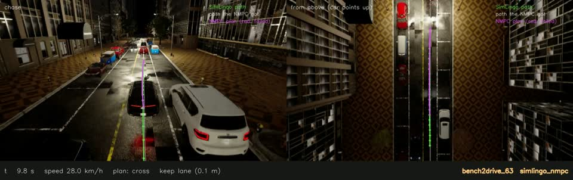

**What happened.** At 7.5–9.9 m/s the planner saw the pedestrian (id 4710) at t ≈ 8.75 s, 11 m ahead and 1.9 m to the
right, and noted "crosser in the lane from 0.2 s to 2.0 s … **cross: no stopping**", i.e. it decided it could not
stop and would pass first. It only braked at about −2 to −4.5 m/s² and hit the pedestrian at t ≈ 9.7 s at about
8 m/s.

**Why.** Once the planner decides it cannot stop for a crosser it keeps going rather than braking as hard as it can.
It also drove at 8–10 m/s past a row of parked cars that hide pedestrians.

**What to try.** For pedestrians, always brake at the limit, even when a full stop is not possible; slow down past parked cars on streets where people can step out.

### InterurbanActorFlow (route 136): Left the road while waiting to turn; ran out of time

**Off road, out of time**. Score 57.2, route 88.6 % done. `Failed - Simulation crashed (watchdog: route over 70 s of simulation time)`. [Video](videos/136_InterurbanActorFlow.mp4)

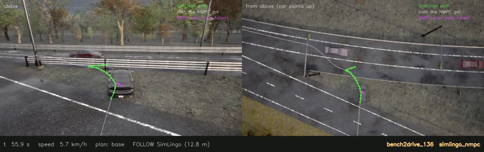

**What happened.** Took 59 s to reach the turn (it waited a long time for a gap in the oncoming flow). At t ≈ 59 s it
moved off and drove onto the verge (`static.terrain`, 1 m outside its lanes), stopped, and ran out of the 70 s
route time at 88.6 %. 72 of 1399 plans failed. The first try of this route **hung**: the simulation stopped
advancing at 19.4 s and the 10 min limit stopped it; the second try is the one scored here.

**Why.** Long waits for a gap in a fast interurban flow, then a turn that clips the verge. The hang is unexplained
(the same as the route 8 hang in todo.md).

**What to try.** Look at why the gap search waits so long on interurban roads; keep the turning path on the lane; find the hang.

### VehicleOpensDoorTwoWays (route 73): Drove past the open door without moving over

**Collision**. Score 60.0, route 100.0 % done. `Completed`. [Video](videos/073_VehicleOpensDoorTwoWays.mp4)

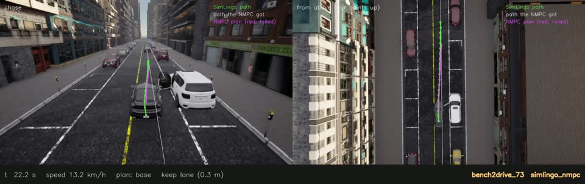

**What happened.** After waiting for oncoming traffic (notes: "blocker: oncoming traffic, waiting"), the car moved off at about
2 m/s. At t ≈ 21.5 s it briefly chose `borrow_left` and then went back to `base` (keep lane, 0.3 m offset) and
drove past the parked SUV whose door was open into our lane. It struck the SUV (id 4708, 2 m ahead and 2.4 m to the
right) at t ≈ 22 s at about 3 m/s (frame below).

**Why.** The open door was not part of the obstacle shape: the SUV is a parked car whose box does not include the
door, so the base plan thought it had room. The borrow candidate was dropped after one plan.

**What to try.** Add the open door to the parked car's footprint (or grow the blocker on its traffic side), so the base plan has to move over or borrow.

### VehicleTurningRoutePedestrian (route 18): Ran a stop sign

**Rule**. Score 80.0, route 100.0 % done. `Completed`. [Video](videos/018_VehicleTurningRoutePedestrian.mp4)

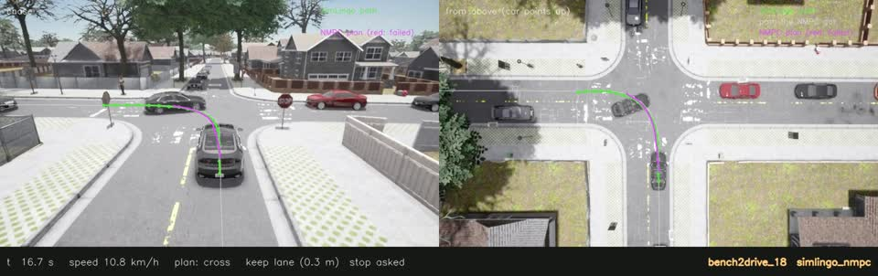

**What happened.** No collision; the pedestrian after the turn was handled. But at t ≈ 17.4 s it went through stop sign 320
at about 5 m/s without coming to a full stop: the plan was `cross`, and the notes say "cross: clear".

**Why.** The crossing check decided the junction was clear, and nothing forced a full stop at the sign first.

**What to try.** Make the stop-sign stop a hard gate that must be met (v ≈ 0 at the line) before any cross or merge candidate can go.

## What to fix first

1. **Junction gap decisions** (routes 103, 210, 14, 19, 136): judge every car in the conflict zone, not one; stick with a choice inside the junction; accept PDM-Lite's gap sizes.
2. **Pedestrians** (route 63): brake at the limit even when a full stop is not possible; slow past parked cars.
3. **Obstacle shapes** (routes 73, 80): the open door belongs to the parked car's footprint; debris is driven over.
4. **Stopped traffic beside us** (route 39): cap speed past a stopped queue in the next lane.
5. **Gates** (routes 114, 18): log where each gate comes from; a stop sign needs a full stop before a cross candidate can go.
6. **Hang** (route 136, first try): the simulation stopped advancing with no error, as on route 8 before.

## Caveats

- One run per type, and runs are not repeatable: route 14 passed on 15 Nov and failed here; route 103 failed both times in the same way. A pass here is not proof the type is solved.
- `--no-cot --fast` (SimLingo without commentary, LoRA merged), as in the runs before. The watchdog ends a route after 30 s at rest or 70 s in all.
- Route 136's first try hung and was stopped at 10 min; it is kept in `runs/136_InterurbanActorFlow.hung1/`.

## Files

- `videos/<route>_<Type>.mp4`: one per run (chase and top view, planner bar)
- `frames/`: the failure frames above; `analysis/`: failure timelines
- `runs/<route>_<Type>/`: leaderboard result (`res/`), logs (`out/`), planner logs (`viz/`); `runs/<name>.log`: the runner's output
- `runs.json`: all results; `routes.txt`, `run_one.sh`, `tools/`: how to rerun and rebuild this report
